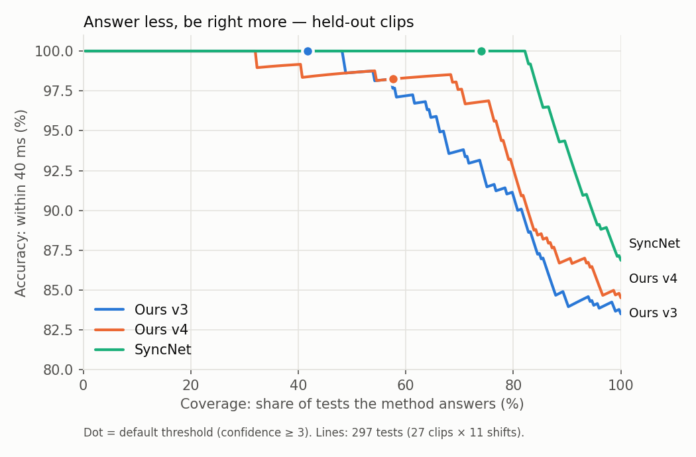

# Audio-Visual Synchronization Error Detection and Correction

**B.Tech Project Report**
Ashish Raj · Supervisor: _(name)_ · _(Department, Institute)_ · October 2026

---

## Abstract

When the sound of a video is out of step with the speaker's lips, viewers notice it after
only a few tens of milliseconds. This project builds a system that detects such errors,
measures them in milliseconds, decides whether a viewer would notice them (ITU-R BT.1359), and
corrects them automatically. The method is classical signal processing:

- a mouth-opening signal is tracked from face landmarks;
- speech energy and onsets are computed from the audio;
- two lip–audio signal pairs are matched by partially whitened cross-correlation;
- the best-matching lag gives the offset, and a peak-prominence score gives a confidence.

It needs no training data and no GPU. The method was developed on 11 studio clips and
tested once on 27 unseen clips: studio actors, phone recordings in English and Hindi, and
AI-reenacted videos. Each clip was tested at 11 known shifts between −300 and +300 ms.

- **Our method:** 85% of the tests within 40 ms (one video frame).
- **SyncNet**, the standard deep-learning baseline, run on the same tests: 87%.
- **Hybrid** (SyncNet gives the coarse offset, our correlation refines it to 10 ms): it keeps
  SyncNet's robustness and lowers the median error on shifts between frames from 10 ms to
  0.3 ms.

The system also found two real problems in a speech-therapy app:

- phone recordings carry about 60–90 ms of extra audio delay;
- an AI video-generation step wrote 29 fps instead of 29.97 fps, so the lips drifted up to
  150 ms behind the voice. This was confirmed lip to lip and fixed.

Finally, the report shows how to detect and correct such *drift*. Errors that grow over time
need about 16–32 s of speech, or a reference video.

---

## 1. Introduction

### 1.1 The problem
Audio and video are recorded, encoded and played through separate paths, and each path can
add delay:

- phone microphones and audio buffers;
- encoders;
- frame-rate conversion;
- video generated or dubbed by AI models.

The result is a lip-sync error: the voice arrives earlier or later than the mouth movement.
Two kinds of error matter:

- **Constant offset:** the audio is shifted by a fixed amount for the whole video.
- **Drift:** the offset grows over time, usually because the video plays at the wrong speed
  (wrong frame rate).

### 1.2 Motivation: a speech-therapy app
The project grew out of a speech-therapy phone app:

- A therapist records a speaking exercise.
- An AI model (LivePortrait reenactment, with Seed-VC voice conversion) turns it into a
  practice video of the patient's own face and voice.
- The patient imitates the practice video, and the patient's recording is scored.

In this setting, lip sync is not cosmetic. A patient who copies a practice video whose lips
are 100 ms late learns the wrong timing.

### 1.3 Contributions
1. **An explainable detector.** It needs no training and measures the offset from mouth
   opening and speech energy, with 10 ms resolution and a confidence score. A verdict
   follows ITU-R BT.1359.
2. **Automatic correction** of constant offsets (shifting the audio) and of drift (re-timing
   the video).
3. **A careful evaluation:**
   - separate development and held-out sets;
   - four groups of real data (studio, phone English, phone Hindi, AI-reenacted);
   - an end-to-end check with real re-encoding;
   - a coverage–accuracy analysis.
4. **A fair comparison with SyncNet** on exactly the same tests, and a **hybrid** that combines
   SyncNet's robustness with our precision.
5. **Two real findings in the app:** phone audio delay, and a frame-rate bug in the
   reenactment pipeline (fixed).

---

## 2. Related work

| Work | Idea | Relation to this project |
|---|---|---|
| Knapp & Carter, 1976 | Generalized cross-correlation (GCC) with PHAT weighting for time-delay estimation | Our peak search, with partial PHAT whitening (PHAT-β) |
| Hershey & Movellan, *Audio Vision*, NIPS 1999 | Mutual information between audio energy and pixel intensity | Same principle: loudness co-varies with the moving face |
| Slaney & Covell, *FaceSync*, NIPS 2000 | Canonical correlation between face images and audio | A linear correlation measure like ours, but learned from pixels |
| ITU-R BT.1359-1, 1998 | Subjective thresholds for lip sync | Our verdict: noticeable at 45 ms early or 125 ms late, acceptable up to 90 ms early or 185 ms late |
| Chung & Zisserman, *SyncNet*, ACCV-W 2016 | CNN embeddings of mouth crops and MFCCs; offset = smallest embedding distance | The standard deep baseline, run here on our tests |
| Kadandale et al., *VocaLiST*, Interspeech 2022 | Cross-modal transformer for lip-sync detection | State of the art; counts a test correct within ±1 frame, the same criterion as ours (40 ms) |

**Asymmetry of perception.** Early audio is noticed much sooner than late audio, because in
nature sound never arrives before the sight. ITU-R BT.1359 therefore uses different limits
for early and late audio, and so does our verdict.

**Our position.** Deep models such as SyncNet are more accurate on hard "in the wild" video
but need large training sets and a GPU, and their output is hard to explain. Our method is
the classical alternative: every number can be traced back to the signals. The hybrid in
Section 4.6 combines the two.

---

## 3. Method

**Sign convention:** offset > 0 means the audio is **late** (heard after the lips move).
ITU uses the opposite sign.

### 3.1 Lip signal
- Face landmarks are found in every frame with MediaPipe Face Mesh. Phone videos are first
  rotated upright using their rotation flag.
- The **mouth aspect ratio (MAR)**, the inner-lip opening relative to mouth width, is computed
  per frame with the same function the therapy app's model uses.
- Frames without a face are filled by linear interpolation.
- A second signal is the **opening speed**: the positive part of the MAR derivative. It peaks
  when the mouth starts to open, just before a syllable.

### 3.2 Audio signals
Audio is resampled to 16 kHz and two signals are computed every 10 ms:

- **Speech-band energy:** log energy between 300 and 3400 Hz, the telephone speech band. It
  ignores low hum and high hiss.
- **Onset strength:** how sharply the spectrum rises. It peaks at the start of each syllable.

The start-time difference between the audio and video streams in the file is read and
applied, so the two signals share one clock.

### 3.3 Matching
Both signals are put on the same 10 ms grid and lightly smoothed (40 ms). Two pairs are
matched:

1. MAR ↔ speech-band energy (*how open* ↔ *how loud*)
2. Opening speed ↔ onset strength (*starts to open* ↔ *starts to sound*)

For each pair:

1. Both signals are partly whitened (PHAT-β, β = 0.3). This flattens their spectra so that
   every speech rhythm counts, which sharpens the correlation peak. Full whitening (β = 1)
   amplifies noise on short clips and was rejected (Table 1).
2. A fixed window from the middle of the lip signal is correlated with the audio at every lag
   from −500 to +500 ms. A fixed window matters: with the full overlap, large lags can win on
   a short overlap by chance.

The two correlation curves are averaged. Speech is rhythmic, so one pair can match one
syllable away; the two pairs make different mistakes, and averaging cancels most of them.
The offset is the lag of the highest point, refined below 10 ms by a parabola through the
peak.

### 3.4 Confidence and verdict
- **Confidence** = (peak − median of the curve away from the peak) / standard deviation of
  the curve away from the peak. It measures how far the best match stands out.
- Below 3, the system reports **"uncertain"** instead of a number.
- Otherwise the offset, minus the natural lip lead (lips move about 80 ms before the sound in
  studio video), is graded with ITU-R BT.1359:

| Verdict | Audio early | Audio late |
|---|---|---|
| in sync | up to 45 ms | up to 125 ms |
| noticeable | up to 90 ms | up to 185 ms |
| unacceptable | beyond 90 ms | beyond 185 ms |

### 3.5 Correction
- **Constant offset:** the audio is delayed (silence added) or advanced (start trimmed) with
  ffmpeg, and the video is copied unchanged. Correction runs only when the confidence is at
  least 3, the error is at least 20 ms, and the peak is not at the edge of the search range.
- **Drift:** the video timestamps are re-scaled by the estimated speed factor (Section 6),
  keeping the same frames.

### 3.6 Hybrid with SyncNet
- SyncNet (Section 5.3) almost never picks the wrong syllable, but it measures in whole
  frames (40 ms).
- Our correlation is precise to 10 ms but sometimes jumps to a wrong syllable far away.
- The hybrid computes our averaged correlation curve, but takes the peak only within **±60 ms
  of SyncNet's offset + 80 ms**. SyncNet has learned to ignore the natural lip lead; our curve
  includes it.
- Both values were chosen on the development set. Every lead from 40 to 100 ms with a window
  of at least 60 ms gave the same result, so the middle of that range was used.

---

## 4. Evaluation protocol

### 4.1 Data

| Set | Clips | Content | Use |
|---|---|---|---|
| Development | 11 | RAVDESS studio clips, 2 actors | All method choices are made here |
| Held-out: actors | 5 | RAVDESS, other actors | Run once, at the end |
| Held-out: phone EN | 6 | Phone recordings, English | Run once |
| Held-out: phone HI | 5 | Phone recordings, Hindi | Run once |
| Held-out: reenacted | 11 | LivePortrait outputs | Run once |

Clips are 3–5 s long. A clip is skipped if a face is found in fewer than half of its frames.

### 4.2 Tests
- Each clip is taken as being in sync.
- Its audio is shifted by −300, −200, −120, −80, −40, 0, +40, +80, +120, +200 and +300 ms.
  This gives 121 tests on dev and 297 on held-out.
- A second "fine" set uses shifts between video frames: ±10, 30, 50, 70, 110 and 150 ms. It
  tests precision rather than robustness.
- Shifts are applied to the audio samples, exactly as ffmpeg's delay and trim do.
- An end-to-end run with real ffmpeg shifting and AAC re-encoding gives the same accuracy
  (84% vs 85%), so the fast simulation is faithful.

### 4.3 Metrics
- **Calibrated error:** detected change minus true shift. The clip's own offset at shift 0 is
  its "in sync" point.
- **≤ 40 ms:** share of tests within one frame at 25 fps (the VocaLiST criterion). Also
  ≤ 20 ms, mean absolute error (MAE) and median error.
- **ITU ok:** share of tests where the sync left after correction would not be noticed.
- **Coverage:** share of tests with confidence of at least 3. **Accurate when confident:**
  ≤ 40 ms among those tests.

---

## 5. Results

### 5.1 Development set (method design)

**Table 1.** Dev set, 121 tests.

| Version | MAE | ≤ 40 ms |
|---|---|---|
| v1: MAR vs loudness, full-overlap correlation | 53.9 ms | 91% |
| v2: + fixed-length window | 51.6 ms | 92% |
| v3: + two-pair ensemble (MAR/loudness + opening speed/onsets) | 19.5 ms | 97% |
| Inner-lip area instead of MAR | 58.2 ms | 90% |
| Full PHAT whitening | 92.2 ms | 81% |
| MAR/speech band + opening speed/onsets | 14.4 ms | 98% |
| **v4: + PHAT-β (β = 0.3)** | **10.4 ms** | **98%** |

The negative results are kept on purpose:

- full whitening hurts badly on short clips;
- the inner-lip area is worse than the simpler MAR.

### 5.2 Held-out set (unseen clips)

**Table 2.** Held-out set, 297 tests, ≤ 40 ms unless stated.

| Method | All | ITU ok | Coverage | Accurate when confident | Actors | Phone EN | Phone HI | Reenacted |
|---|---|---|---|---|---|---|---|---|
| v3 | 84% | 86% | 42% | 100% | 93% | 98% | 100% | 64% |
| **v4** | **85%** | **86%** | **58%** | **98%** | 93% | 98% | **100%** | 66% |

- **Phone video and Hindi speech** work almost perfectly (98–100%), although the method was
  developed on English studio clips.
- **v4's gain over v3 shrinks on unseen data.** Most of the improvement is in confidence:
  coverage rises from 42% to 58%. This is why a held-out set matters.
- **The reenacted group is the weak spot.** In 6 of the 11 videos the generated lips do not
  follow the audio at *any* shift (peak correlation 0.03–0.08). The detector reports these as
  "uncertain", which is the correct answer.

### 5.3 Baseline: SyncNet
- **Weights.** We used the official SyncNet weights (`syncnet_v2.model`). The weights file was
  downloaded twice from independent mirrors and both copies had the same SHA-256 checksum.
  It is loaded as plain data into our own implementation of the network.
- **Pipeline.** It follows the official one: 25 fps, the official face-crop formula, 5-frame
  windows, MFCC audio features and a search of ±15 frames. The one difference is that the face
  box comes from MediaPipe instead of the S3FD detector.

**Table 3.** SyncNet on the same tests.

| Method | Dev ≤ 40 ms | Held-out ≤ 40 ms | Held-out MAE | Coverage | Accurate when confident |
|---|---|---|---|---|---|
| Ours v4 | 98% | 85% | 101 ms | 58% | 98% |
| **SyncNet** | **100%** | **87%** | **28 ms** | **74%** | **100%** |

Per group on held-out, ours v4 / SyncNet: actors 93 / 100, phone EN 98 / 100,
phone HI 100 / 100, reenacted 66 / 68.

SyncNet is better, as expected from a network trained on hundreds of hours of TV. The gap is
small on clean talking faces, and both methods fail on the same broken reenacted videos.

### 5.4 Coverage vs accuracy
Each method can decline to answer when it is unsure. Because the confidence scales differ,
the methods are compared at equal coverage.

**Table 4.** Accuracy (≤ 40 ms) when only the most confident share of tests is answered.

| Coverage | 50% | 75% | 90% | 100% |
|---|---|---|---|---|
| Ours v3 | 98.7% | 91.5% | 84.0% | 83.5% |
| Ours v4 | 98.7% | 96.9% | 86.9% | 84.5% |
| SyncNet | 100% | 100% | 93.7% | 86.9% |
| *Without reenacted:* ours v4 | 98.9% | 98.5% | 98.1% | 97.2% |
| *Without reenacted:* SyncNet | 100% | 100% | 100% | 100% |

On real camera video (excluding the broken reenactments), our method stays above 97% at every
coverage level.

### 5.5 Hybrid

**Table 5.** Held-out set.

| Method | MAE | Median | ≤ 40 ms | ≤ 20 ms | ITU ok |
|---|---|---|---|---|---|
| ***Standard shifts*** | | | | | |
| Ours v4 | 101 ms | 0.5 ms | 85% | 83% | 86% |
| SyncNet | 28 ms | 0.0 ms | 87% | 85% | 89% |
| **Hybrid** | 31 ms | 0.4 ms | **87%** | **86%** | 89% |
| ***Fine shifts (between frames)*** | | | | | |
| Ours v4 | 63 ms | 0.3 ms | 90% | 89% | — |
| SyncNet | 25 ms | 10 ms | 89% | 71% | 92% |
| **Hybrid** | **18 ms** | **0.3 ms** | 88% | **85%** | **93%** |

- **On the standard shifts, the hybrid ties SyncNet.** These shifts are mostly multiples of
  40 ms, so whole-frame steps are never penalized.
- **On shifts between frames, SyncNet is typically 10 ms off.** The hybrid brings the median
  error to 0.3 ms and has the lowest mean error, without our method's occasional far-away
  wrong-syllable jumps.
- **The hybrid cannot repair what SyncNet gets wrong:** the reenacted group stays at about 70%.

---

## 6. Findings on real data

### 6.1 Phone recordings carry extra audio delay
Natural lip lead measured at shift 0:

| Source | Offset |
|---|---|
| Studio clips (RAVDESS) | +65 to +97 ms (median ≈ +80 ms) |
| Phone clips, English and Hindi | median ≈ +145 ms |
| Patient recordings from the app | +167 to +176 ms |

- Phone capture therefore adds about **60–90 ms** of audio delay.
- SyncNet, which has learned to ignore the natural lead, independently reads the phone clips
  as **+40 ms** late against 0 ms for studio clips.
- This matters when a patient's recording is compared frame by frame with a practice video.

### 6.2 The practice videos were 3% slow
- **Symptom.** The detector measured the app's reenacted practice videos at +2 to +12 ms,
  against +84 ms for the therapist video they were made from.
- **Lip-to-lip comparison.** Comparing the two videos' lips (no audio) showed that frame *i*
  of the practice video equals frame *i* of the therapist video, but the file is labelled
  **29 fps instead of 29.97 fps**.
- **Cause.** The reenactment code writes `int(fps)`, which turns 29.97 into 29 (the model code
  was only read, never changed). The video is 3.2% slow, and the lips drift up to 150 ms
  behind the voice by the end.
- **Fix.** In the app's own wrapper, the same frames are re-timed to the original frame rate.
- **Result.**

| Measure | Before fix | After fix |
|---|---|---|
| Offset | +12 ms | +68 ms (therapist original: +84 ms) |
| Confidence | 4.4 | 5.5 |
| Verdict | noticeable | in sync |

### 6.3 Voice conversion keeps sync
Replacing the therapist's voice with the patient's (Seed-VC) changes the offset from +68 ms to
+66 ms, so the voice-conversion step does not affect sync.

---

## 7. Drift

**Model.** offset(t) = offset₀ + drift · t, and speed = 1 + drift / 1000. A video written at
29 fps instead of 29.97 fps drifts by −32 ms per second.

**Lips against audio.** The estimator searches over speed (0.95–1.05) and offset together.

- **Simulation.** A wrong frame rate is simulated exactly by scaling the lip timestamps, using
  7 speeds from 0.97× to 1.03×. Longer recordings are built by joining in-sync clips.
- A case counts as fixed when the sync left at the end after correction is within 40 ms.

**Table 6.** Share of drift cases fixed.

| Video length | Dev | Phone EN + HI | Actors |
|---|---|---|---|
| 4 s | 6% | 27% | 24% |
| 8 s | 32% | 29% | 56% |
| 16 s | 89% | 59% | 86% |
| 32 s | **94%** | **100%** | (only 25 s of data) |

- Lips against audio needs **16–32 s of speech**. On short clips the natural lip lead jitters by
  tens of milliseconds per syllable, which is as much as the drift itself.
- A sliding-window estimator with a line fit was tried and rejected on dev.

**Lips against a reference video.** Reenacted and dubbed videos have a source video with the
same mouth motion, so lips can be matched to lips.

- On the 6 real 4.6 s practice videos, the method found −35 to −36 ms/s (true value
  −32.4 ms/s). The therapist video matched against itself gives exactly 0.
- The error left at the end is at most 17 ms, under one frame, so all 6 videos were
  corrected.

---

## 8. Limitations

- **Few speakers.** There are 2 actors in the dev set, and all phone clips come from a single
  speaker.
- **The true zero is assumed.** The original clips are taken as being in sync; this was not
  measured with a clapper board.
- **Synthetic shifts are exact.** Shifts are sample-exact, which is why median errors are near
  0 ms. Real errors also include encoder jitter. The end-to-end check covers part of this.
- **Short clips.** At 3–5 s, coverage at the fixed threshold is modest (58%), and drift cannot
  be measured without a reference video.
- **Broken reenactments.** When the generated lips do not follow speech, no detector can
  measure an offset. Ours correctly says "uncertain".

---

## 9. Conclusion and future work

A classical, training-free detector based on lip and speech-energy correlation reaches 85% of
tests within one frame on unseen studio, phone, Hindi and AI-generated video. SyncNet reaches
87%. On real camera video our detector is above 97% accurate at every coverage level. It
corrects constant offsets and, with enough speech or a reference video, drift. Combined with
SyncNet, it gives SyncNet's robustness with 10 ms precision. Applied to a real speech-therapy
app, it exposed:

- a phone audio delay of 60–90 ms;
- a frame-rate bug that had made the practice videos drift up to 150 ms (fixed).

**Future work:**
1. A confidence score for the hybrid that combines SyncNet's confidence with the sharpness of
   our peak.
2. A confidence threshold that adapts to clip length.
3. More speakers and more Hindi data, and one clapper-board recording for a measured true
   zero.
4. Drift on real long recordings and on variable-frame-rate phone video.
5. Running the detector inside the app as an automatic check on every generated practice video.

---

## References

1. C. Knapp and G. Carter, "The generalized correlation method for estimation of time delay," *IEEE Trans. Acoustics, Speech, and Signal Processing*, 24(4), 1976.
2. J. Hershey and J. Movellan, "Audio Vision: Using audio-visual synchrony to locate sounds," *NIPS*, 1999.
3. M. Slaney and M. Covell, "FaceSync: A linear operator for measuring synchronization of video facial images and audio tracks," *NIPS*, 2000.
4. ITU-R Recommendation BT.1359-1, "Relative timing of sound and vision for broadcasting," 1998.
5. J. S. Chung and A. Zisserman, "Out of time: automated lip sync in the wild," *ACCV Workshops*, 2016.
6. V. S. Kadandale, J. F. Montesinos, and G. Haro, "VocaLiST: An audio-visual synchronisation model for lips and voices," *Interspeech*, 2022.
7. S. R. Livingstone and F. A. Russo, "The Ryerson Audio-Visual Database of Emotional Speech and Song (RAVDESS)," *PLoS ONE*, 2018.
8. C. Lugaresi et al., "MediaPipe: A framework for building perception pipelines," arXiv:1906.08172, 2019.
9. J. Guo et al., "LivePortrait: Efficient portrait animation with stitching and retargeting control," arXiv:2407.03168, 2024.
